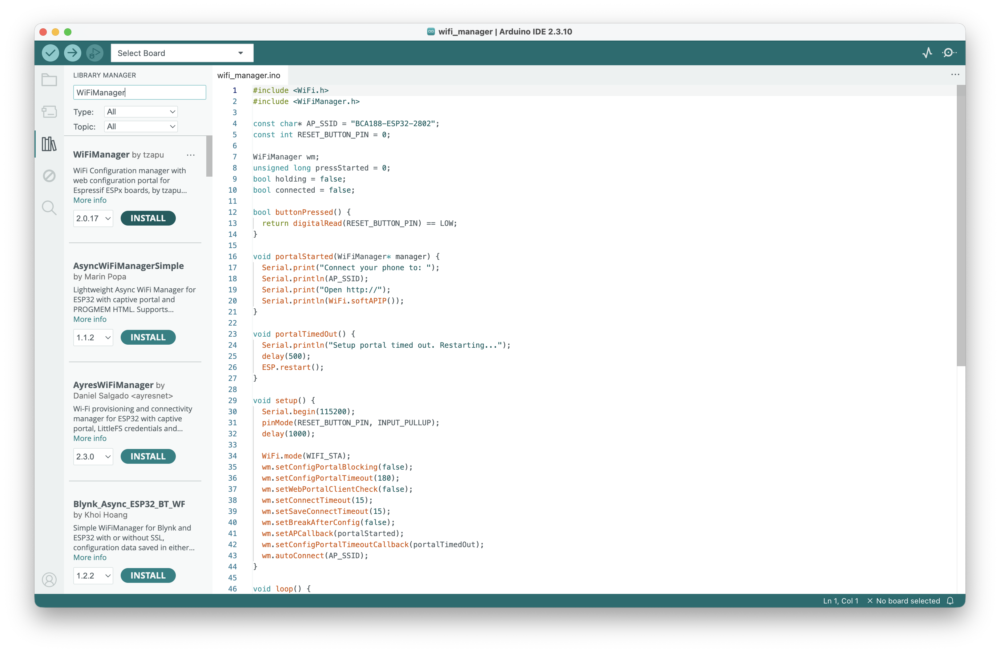
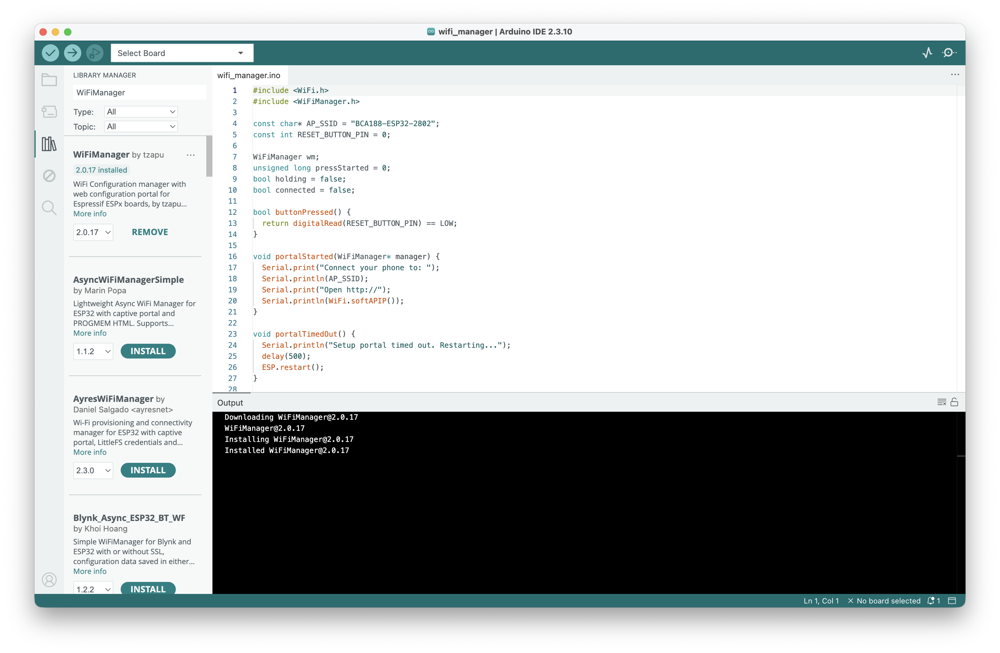
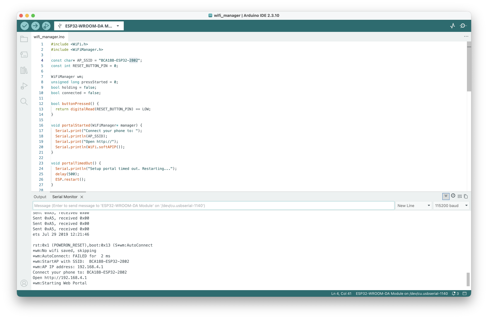
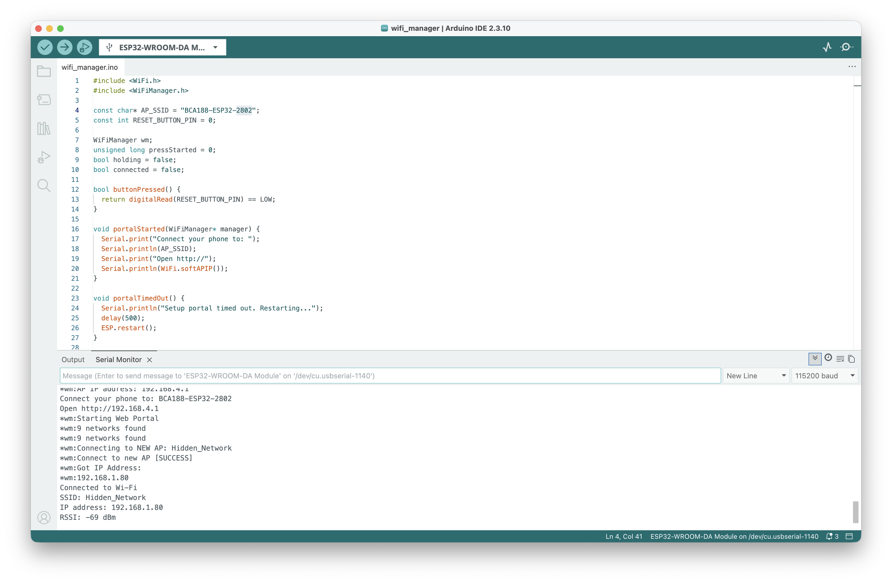
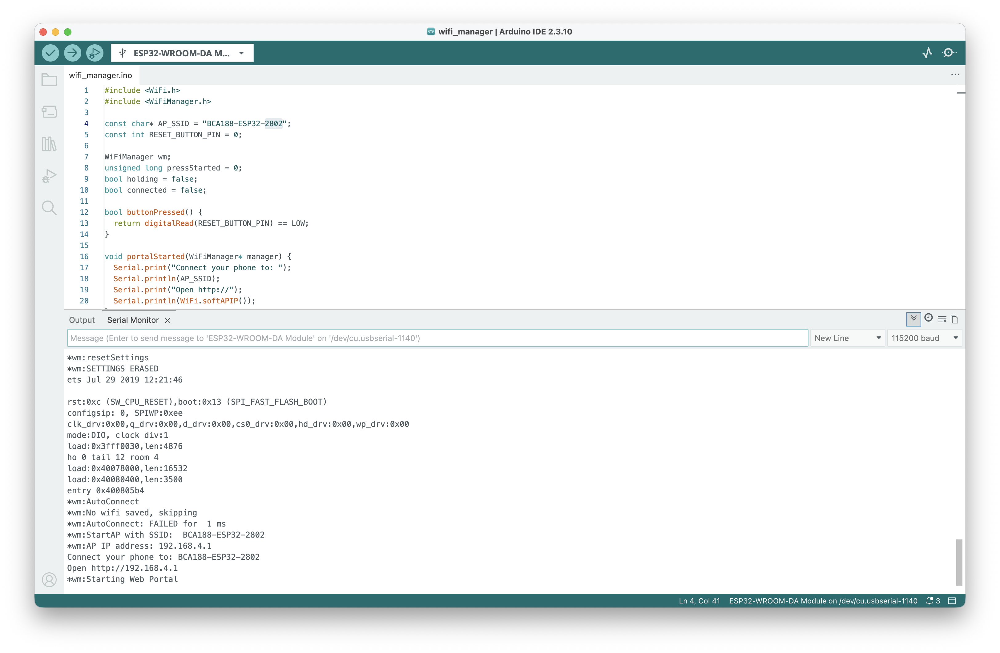
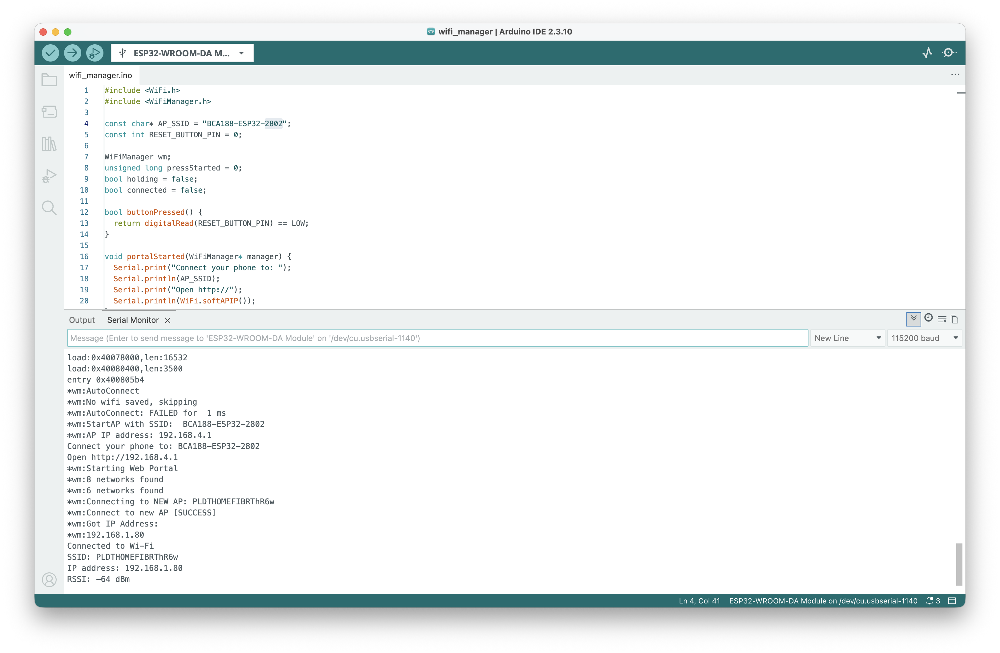
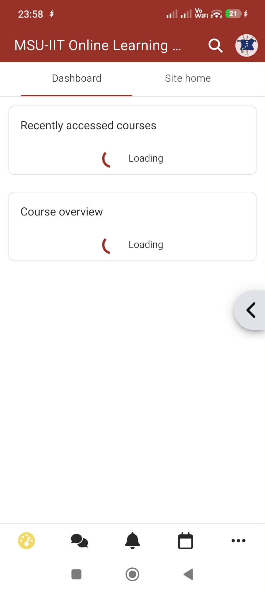

# Laboratory Activity 9: ESP32 Wi-Fi Manager

**Rhea Leen P. Castor**

**Assigned number: 2802**

BCA188 - Programming For Internet of Things

I used WiFiManager to connect my ESP32 to two Wi-Fi networks without changing the network details in the code.

## Materials

- ESP32 board and USB data cable
- Computer with Arduino IDE and ESP32 board support
- WiFiManager by tzapu, version **2.0.17**
- Phone and two 2.4 GHz Wi-Fi networks

## My setup

My code is in [wifi_manager.ino](wifi_manager/wifi_manager.ino). I used **BCA188-ESP32-2802** as the setup network name and **115200 baud** for Serial Monitor. The setup portal opened at **http://192.168.4.1**.

The code sets a **180-second** portal timeout and restarts the ESP32 if setup is not completed. Holding the built-in BOOT button on GPIO0 for 3 seconds and releasing it clears saved Wi-Fi and reopens setup. No extra wiring is needed.

## Results

| Connection | SSID | Assigned IP | RSSI | Screenshot |
|---|---|---|---|---|
| First network | Hidden_Network | 192.168.1.80 | -69 dBm | [Uploaded](documentation/network-hidden.png) |
| Second network | PLDTHOMEFIBRThR6w | 192.168.1.80 | -64 dBm | [Uploaded](documentation/network-pldt.png) |

Both connections received the same local IP address. The SSIDs in Serial Monitor show which network was connected.

| Check | Observed |
|---|---|
| Library setup | WiFiManager 2.0.17 was installed in Arduino IDE. |
| Setup portal | BCA188-ESP32-2802 opened at 192.168.4.1. |
| Reset settings | Serial Monitor showed SETTINGS ERASED, a software reset, and the setup portal opening again. |
| Different network | I connected to PLDTHOMEFIBRThR6w after Hidden_Network using the same sketch. |
| Wrong password | Separate test evidence not yet uploaded. |
| Change the setup name | BCA188-ESP32-2802 is confirmed in the code and startup output; a separate rename test is not yet documented. |

The timeout is configured in the code, but I have not included a recording of the full 180-second timeout. My phone setup-page screenshot and test videos are also not uploaded yet.

## Documentation

My original screenshots are saved in [documentation](documentation/).

1. WiFiManager library setup

I located **WiFiManager by tzapu** in Library Manager, then installed version **2.0.17**.

2. Setup network and portal startup

Serial Monitor shows **BCA188-ESP32-2802** and **192.168.4.1**, followed by the web portal starting. The SPI lines above the reset are older output from Lab 8.

3. First network — Hidden_Network

The ESP32 connected successfully to **Hidden_Network** with IP **192.168.1.80** and RSSI **-69 dBm**.

4. Saved settings erased and portal reopened

The log shows **resetSettings**, **SETTINGS ERASED**, and a software reset. After restarting, the ESP32 had no saved Wi-Fi and opened the setup portal again.

5. Second network — PLDTHOMEFIBRThR6w

The ESP32 connected successfully to **PLDTHOMEFIBRThR6w** with IP **192.168.1.80** and RSSI **-64 dBm**.

## Explanation

WiFiManager saves Wi-Fi credentials in the ESP32's flash memory. I cleared the saved settings and entered the second network's details through the setup portal, so I did not need to change the Wi-Fi name or password in my code.

Reference activity: [Lab 9 example](https://github.com/mccdz1/BCA188-Lab9-ESP32-WiFi-Manager). Library: [WiFiManager](https://github.com/tzapu/WiFiManager).

## MOLE access issues

I could not open the MOLE sign-in page in Safari on October 23 at 11:56 PM. My mobile dashboard also showed loading indicators.

Desktop sign-in error and mobile loading screen

**Desktop:** Safari reported that the server unexpectedly dropped the connection.

**Mobile:** the dashboard showed loading indicators at 23:58.

